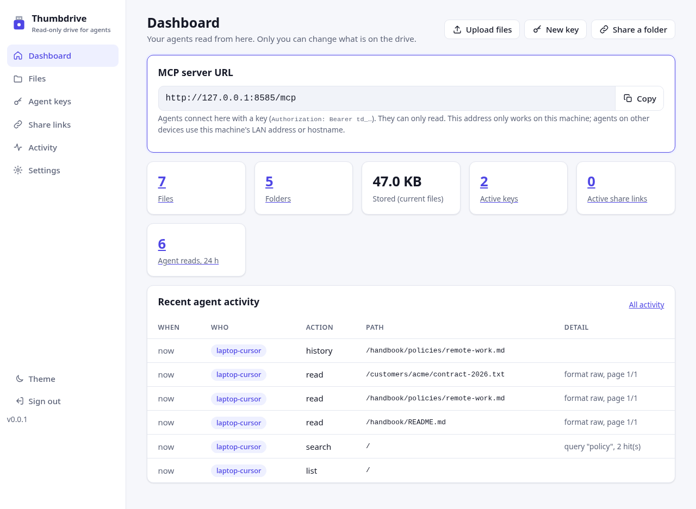
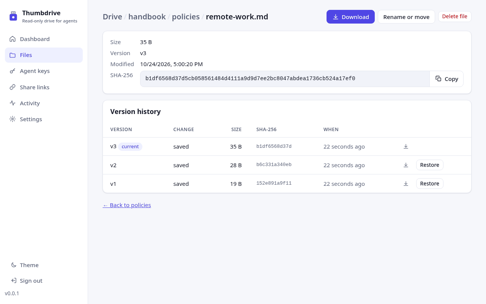
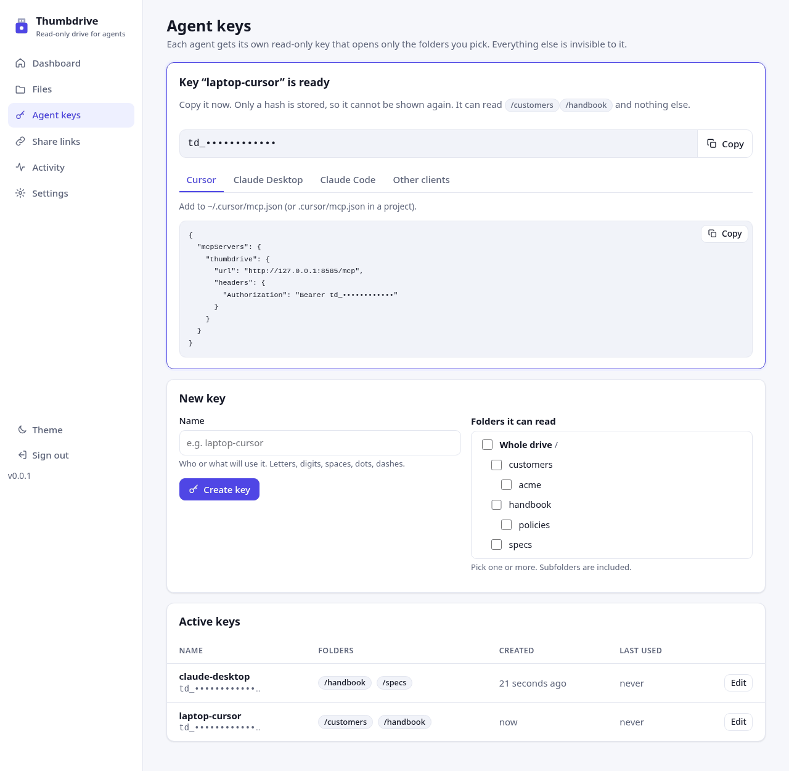

# Thumbdrive MCP

A USB stick you load for your agents: you put files on it, they read exactly what you put there, with a checksum to prove it, and nothing they do can change it.

Thumbdrive is a small, self-hosted [MCP](https://modelcontextprotocol.io) server. You manage files; any MCP agent (Claude Desktop, Cursor, VS Code and others) reads them byte-for-byte from only the folders you share with it.

- **Read-only for agents.** Four tools: `list`, `read`, `search`, `history`. No agent can write, rename or delete.
- **Exact.** Every read returns the file's SHA-256 so the agent can verify it got the right bytes.
- **Versioned.** Every change you make is kept; nothing is silently overwritten.
- **Plain files.** Current files live as normal files on a mounted folder, plus a small SQLite database. Backup means copying the folder.
- **Folder keys.** Each agent gets its own key that opens only the folders you choose. Everything else is invisible to it.
- **A web UI for you.** Upload, organize and restore files, hand out keys with ready-to-paste client configs, share a folder with a person by link, and see what your agents read. Agents never get write access; every change goes through the UI or the CLI.

> Status: early development (milestones M1 and M3).

## Web UI

Manage the drive from your browser. Agents never get write access; every change goes through the UI or the CLI.



| Files, versions and restore | Agent keys with ready-to-paste client configs |
| --- | --- |
|  |  |

**Try it in two minutes** with Docker or Portainer (image tag `:edge`, which follows main; `:m3` also works):

1. Deploy [`docker-compose.yml`](docker-compose.yml): run `docker compose up -d`, or paste it into Portainer under **Stacks → Add stack** (see [docs/portainer.md](docs/portainer.md)). It uses `ghcr.io/hkrlogic/thumbdrive-mcp:edge`.
2. Open **http://HOST:8484/**. `HOST` is `127.0.0.1` on the Docker host, or its LAN IP if you publish `8484:8484`.
3. Choose the admin password on the first screen. Or set `THUMBDRIVE_ADMIN_PASSWORD` in the compose file before the first start, so no one else can set it first.
4. Drop files on **Files**, create a key on **Agent keys**, and paste the snippet into Cursor, Claude Desktop or Claude Code.

**Docs:**

- [Web UI guide](docs/web-ui.md): every screen, with screenshots
- [Configuration and CLI reference](docs/configuration.md): every environment variable and admin command
- [Security](docs/security.md): sign-in, sessions, CSRF, HTTPS, read-only agents, hashed keys and links
- [Portainer setup](docs/portainer.md)
- [Changelog](CHANGELOG.md)

## Quick start

Requires Node 22.13 or newer, or Docker.

```sh
git clone https://github.com/hkrlogic/thumbdrive-mcp.git
cd thumbdrive-mcp
npm ci

npm start            # web UI on http://127.0.0.1:8484/, MCP on /mcp
```

Open http://127.0.0.1:8484/ and set the admin password (first run only). Then drop files on **Files**, create a key on **Agent keys** and paste the snippet it shows into your client.

Everything also works from the CLI:

```sh
npm run admin -- import ~/Documents/handbook /team
npm run admin -- key create my-agent --folder /team   # prints td_... once
```

With Docker (images for amd64 and arm64 are published to `ghcr.io/hkrlogic/thumbdrive-mcp`):

```sh
docker compose up -d     # uses docker-compose.yml, then open http://127.0.0.1:8484/
```

Or build it yourself:

```sh
docker build -t thumbdrive-mcp .
docker run -d --init --name thumbdrive -e THUMBDRIVE_HOST=0.0.0.0 \
  -p 127.0.0.1:8484:8484 -v thumbdrive-data:/data thumbdrive-mcp
```

Portainer: see [docs/portainer.md](docs/portainer.md).

The server listens on localhost unless `THUMBDRIVE_HOST` is set, and that includes inside a container. The compose file sets `THUMBDRIVE_HOST=0.0.0.0` and publishes the port on `127.0.0.1` only. Change the port to `8484:8484` to reach it from your home network. Plain HTTP is accepted from localhost and private networks (10/8, 172.16/12, 192.168/16, 100.64/10 and IPv6 ULA). It is refused from public addresses, so for anything beyond the LAN put HTTPS in front (Caddy or Cloudflare Tunnel).

## Web UI pages

The UI is served at `/` on the same port as `/mcp`. See the [Web UI guide](docs/web-ui.md) for details.

| Page | What you can do |
| --- | --- |
| Dashboard | Copy the MCP URL, see counts and recent agent reads |
| Files | Browse; create, rename, move and delete folders; drag and drop files or whole folders to upload; download, rename, move and delete files; view a file's versions and restore any of them; restore deleted files |
| Agent keys | Create a key for one or more folders. The key is shown once, with a copy button and snippets for Cursor, Claude Desktop (via `mcp-remote`), Claude Code and other clients that use the address you opened the UI on. Change a key's folders or revoke it |
| Share links | Give a person read-only browser access to one folder: 1 hour, 1 day (default), 7 days or 30 days. Links are random 256-bit tokens stored as hashes. Revoke any time |
| OUI database | CyberDrive: import or refresh the MAC vendor (OUI) database, see its version, rows, source and SHA-256, and which keys can query it. See [docs/cyberdrive.md](docs/cyberdrive.md) |
| Windows events | CyberDrive: the same for Microsoft's Windows security audit events catalog |
| Activity | Every agent read (key, tool, path, time), filterable by key, action and path; optionally your own changes and share-link downloads |
| Settings | Change the admin password (signs out every other session) |

**Admin account.** There is one admin password. On first run the UI asks you to set it. You can instead set `THUMBDRIVE_ADMIN_PASSWORD` (applied at start; changing it signs out all sessions) or run `admin set-password`. Passwords are stored as scrypt hashes.

**Security.** Sign-in uses a single scrypt-hashed password and a 7-day `HttpOnly`, `SameSite=Strict` session cookie. Every change is CSRF-checked, pages carry a strict CSP, and downloads are sandboxed. The UI follows the same Host/Origin allow-list and HTTPS rules as `/mcp`, so a hostname such as `nas.local` must be in `ALLOWED_HOSTS` (or be `THUMBDRIVE_PUBLIC_URL`). Until a password is set, the first person to open the UI can set one. Set `THUMBDRIVE_ADMIN_PASSWORD`, or keep the port on localhost or your LAN until you have opened it once. Details: [docs/security.md](docs/security.md).

## Connect an agent

The **Agent keys** page writes these for you. By hand, for Streamable HTTP (most clients):

```json
{
  "mcpServers": {
    "thumbdrive": {
      "url": "http://127.0.0.1:8484/mcp",
      "headers": { "Authorization": "Bearer td_..." }
    }
  }
}
```

stdio (the client starts the server itself):

```json
{
  "mcpServers": {
    "thumbdrive": {
      "command": "npx",
      "args": ["tsx", "/path/to/thumbdrive-mcp/src/index.ts", "--stdio"],
      "env": { "THUMBDRIVE_KEY": "td_...", "DATA_DIR": "/path/to/thumbdrive-mcp/data" }
    }
  }
}
```

Check a running server end to end: `THUMBDRIVE_KEY=td_... npm run smoke -- http://127.0.0.1:8484/mcp`.

## Tools

All four are annotated `readOnlyHint: true`. Anything outside the key's folders answers `Not found`, exactly like a missing file.

| Tool | What it does |
| --- | --- |
| `list(path)` | Files and folders with size, SHA-256 and modified time |
| `read(path, format, page, version, base64)` | Paged read. `raw` gives UTF-8 text, or base64 for binaries (or when `base64` is true). `text` gives CSV/TSV as JSON rows, and text files as text. Returns metadata JSON (sha256, version, page, pages, has_more...) then the content |
| `search(query, path)` | Case-insensitive match on names and text content, up to 50 hits |
| `history(path)` | Stored versions, newest first; read one with `read(path, version)` |

Text views for Excel, PDF and Word files are not built yet: `format: "text"` says so, and `format: "raw"` returns them as base64.

## CyberDrive

CyberDrive adds read-only security reference datasets that agents query with cited answers: the MAC address vendor (OUI) database and Microsoft's Windows security audit events catalog.

| Tool | What it does |
| --- | --- |
| `lookup_mac(macs)` | Up to 50 MACs or prefixes in any common format (`00:1A:2B:3C:4D:5E`, `00-1a-2b-...`, `001a.2b3c.4d5e`, `001A2B`). Longest-prefix match (MA-S 9, MA-M 7, then MA-L 6 nibbles); flags locally administered and multicast addresses; says `No match` explicitly. Each match has a citation such as `cyberdrive:oui@v3#00:00:0C` |
| `search_oui_vendor(query, limit)` | Find prefixes by vendor name |
| `lookup_windows_event(ids)` | Up to 50 Windows Security log event IDs: category > subcategory, summary, minimum OS and every version's detailed message, with a citation such as `cyberdrive:winevent@v1#4624`; explicit `No match` |
| `search_windows_events(query, category, limit)` | Text search over summaries and messages, optionally within one audit category |

The datasets are not bundled (the OUI data includes GPLv2 Wireshark and Nmap data; the Windows catalog is Microsoft's download). Import them from **OUI database** and **Windows events** in the web UI (upload, or **Refresh from source**) or with `npm run admin -- cyberdrive oui import` and `cyberdrive winevent import`. The Windows catalog is Microsoft's 2016 list: it does not cover newer Windows 10/11 events or Sysmon. Keys get each dataset's tools only when you grant that dataset; a whole-drive key does not get it automatically. Every lookup is logged. Details, the access model, output format and license note: [docs/cyberdrive.md](docs/cyberdrive.md).

## Admin CLI

Every command is described in [docs/configuration.md](docs/configuration.md#admin-cli).

```text
npm run admin -- put <local-file> <drive-path>
npm run admin -- import <local-folder> <drive-folder>
npm run admin -- mkdir | rm | ls | history <drive-path>
npm run admin -- mv <drive-path> <new-drive-path>
npm run admin -- restore <drive-path> <version>
npm run admin -- key create <name> [--folder <folder> ...] [--dataset oui|winevent ...]
npm run admin -- key datasets <name> [oui] [winevent]
npm run admin -- cyberdrive oui import [path-or-url] | status
npm run admin -- cyberdrive oui lookup <mac> ... | search <vendor>
npm run admin -- cyberdrive winevent import [path-or-url] | status
npm run admin -- cyberdrive winevent lookup <id> ... | search [text] [--category <category>]
npm run admin -- key list | key revoke <name>
npm run admin -- activity [count]
npm run admin -- set-password         # prompts, or reads the first line of stdin
```

## Storage

```text
data/
  files/        current files, as plain files
  versions/     every stored version, named by SHA-256
  thumbdrive.db versions, hashed keys and share links, admin password hash,
                sessions, activity log, CyberDrive datasets (SQLite)
```

Every admin change adds a version; deletes keep history. Files you copy into `data/files` by hand are served too, and get their first version on the next admin change. Symlinks inside the drive are ignored.

## Configuration

The main settings are below. [docs/configuration.md](docs/configuration.md) lists every variable, with examples.

| Variable | Default | |
| --- | --- | --- |
| `DATA_DIR` | `./data` | Mounted data folder |
| `PORT` | `8484` | |
| `THUMBDRIVE_HOST` | `127.0.0.1` | Address to listen on. Set `0.0.0.0` in containers (the compose file does). `BIND_HOST` also works |
| `ALLOWED_HOSTS` | | Host names accepted in `Host`/`Origin` besides localhost and private IPs, comma separated (e.g. `nas.local`) |
| `ALLOW_INSECURE_HTTP` | | `1` accepts plain HTTP from public addresses. Not recommended |
| `MAX_FILE_MB` | `50` | Largest file the admin can store or upload |
| `DATASET_MAX_MB` | `100` | Largest CyberDrive dataset file (upload, download or CLI import) |
| `CYBERDRIVE_AUTO_REFRESH` | | `1` re-downloads imported datasets from their source when older than 30 days. Off by default |
| `READ_PAGE_BYTES` | `65536` | Bytes per read page |
| `READ_PAGE_ROWS` | `200` | Rows per CSV page |
| `RATE_LIMIT_PER_MINUTE` | `120` | Requests per key per minute |
| `THUMBDRIVE_ADMIN_PASSWORD` | | Sets the admin password at start (at least 8 characters). Without it, the UI asks on first run |
| `THUMBDRIVE_PUBLIC_URL` | | The address people and agents use, e.g. `https://drive.example.com`. Used for the MCP URL, key snippets and share links, and its host is allowed. By default the UI uses the address you opened it on |
| `THUMBDRIVE_KEY` | | Key for `--stdio` mode |

## Development

```sh
npm run typecheck
npm run lint
npm test
npm run build        # compiles to dist/, which is what the image runs
```

## License

Apache License 2.0. See [LICENSE](LICENSE) and [NOTICE](NOTICE). The license does not grant rights to the Thumbdrive name.
