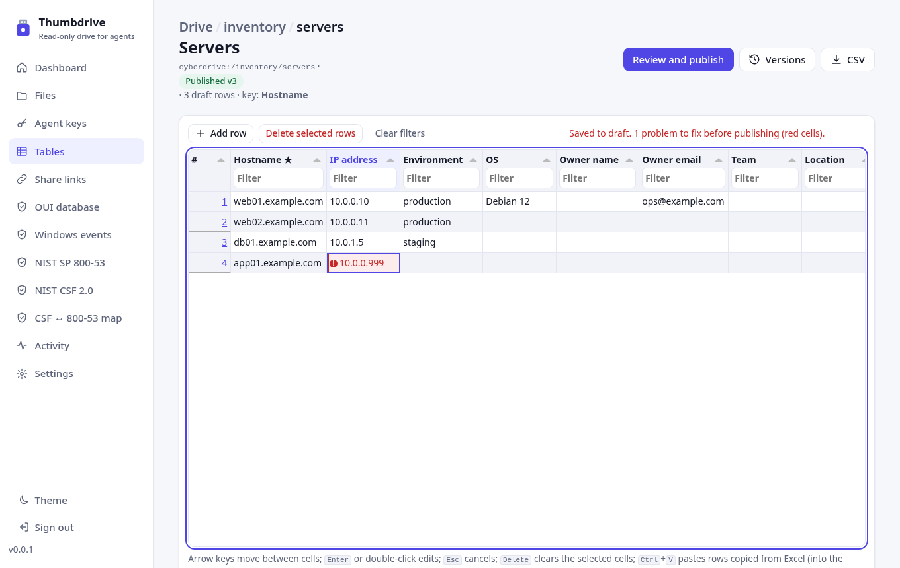
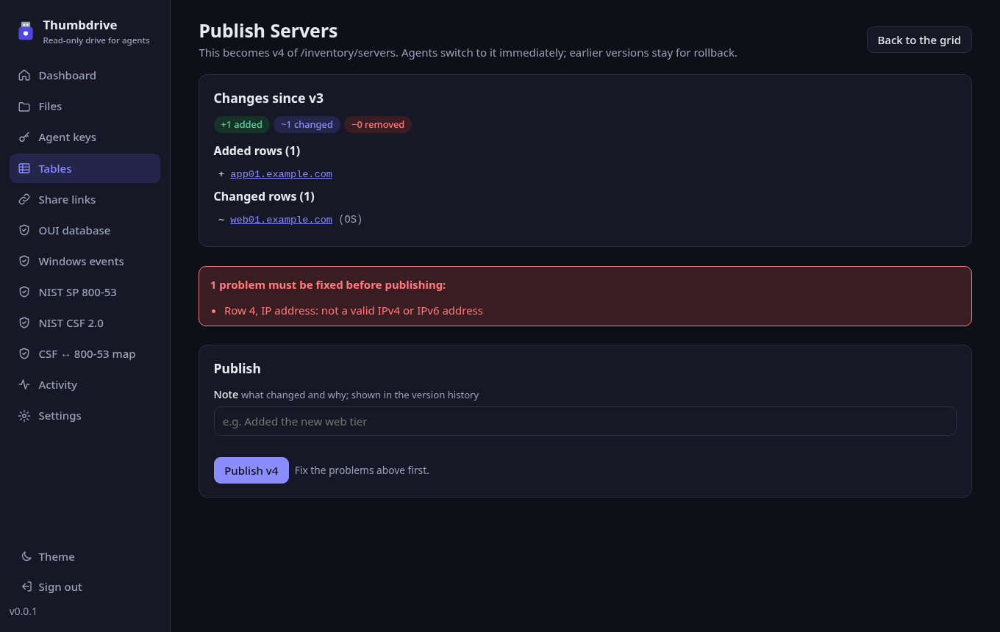
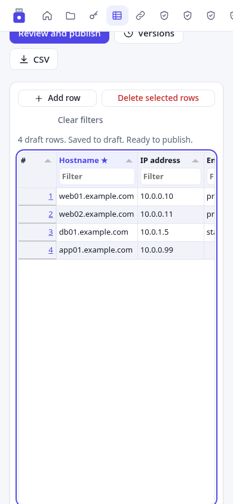
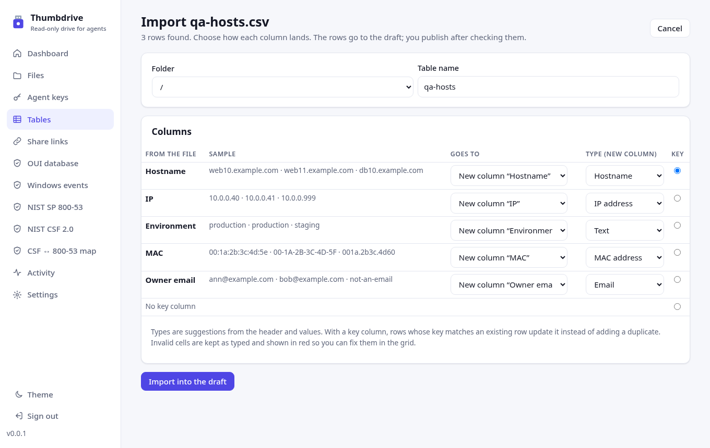

# CyberDrive tables

Tables are small, typed, user-edited datasets, such as a server inventory or an IP plan. You edit them in a grid in the web UI and publish them as numbered versions. Agents then query the latest published version with cited answers. Agents cannot write to tables.



## Where a table lives and who can see it

A table has a **folder path**, for example `/inventory/servers` is the table `servers` in the folder `/inventory`. The table uses the drive's existing access rules:

- **Agent keys.** A key sees a table only when the table's folder is inside one of the key's folders (the same `scope` check as `list` and `read`). Keys for the whole drive see every table. A table outside the key's folders gives `Not found`, the same answer as a table that does not exist.
- **Share links.** A share link for a folder shows the published tables in that folder and its subfolders. The share page is read-only HTML (the first 2,000 rows) and has a CSV download. Drafts are never shown. Downloads are logged as `table.download`.
- **Dataset grants** (`oui`, `nist80053`, `csf2` and the others) do **not** grant access to tables, and tables do not need a dataset grant. A dataset grant only adds context to `lookup_row` results. When the key also holds `oui`, MAC cells get a `vendor`. When it holds `nist80053` or `csf2`, control-ID cells get a `title`. Both come with the dataset citation.
  *Why:* folders already express "which data this agent may see" and how things are shared. Dataset grants describe reference catalogs that you import, not your own data. If tables were tied to dataset grants, there would be two access lists to keep in step.
- The four table tools appear for any key that has at least one folder. Dataset-only keys do not get them.

A folder that contains a table cannot be deleted until you delete or move the table. Moving or renaming a folder moves its tables, as it does for keys and share links. A file can still be created at the same path as a table. They are separate objects, and the tools for each are separate.

## Columns and types

| Type | Accepts | Stored as |
| --- | --- | --- |
| Text | up to 2,000 characters | as typed (trimmed) |
| Long text | up to 20,000 characters, multi-line | as typed |
| Number | integers or decimals, `1,234.5` allowed | number |
| Date | `YYYY-MM-DD` (also `YYYY/MM/DD`) | `YYYY-MM-DD` |
| Checkbox | `true/false`, `yes/no`, `1/0`, `x` | boolean |
| Single select | one of the column's options (up to 100), case-insensitive | the option's spelling |
| URL | `http://` or `https://` URLs | as typed |
| Email | `name@domain.tld` | as typed |
| Hostname | RFC 1123 names, FQDN or short | lower case, no trailing dot |
| IP address | IPv4 or IPv6 | canonical (IPv6 compressed, lower case) |
| CIDR | `10.0.0.0/24`, `2001:db8::/32` | canonical network address. Host bits set is an error |
| MAC | `00:1A:2B:3C:4D:5E`, `00-1a-2b-…`, `001a.2b3c.4d5e`, `001A2B3C4D5E` | `00:1A:2B:3C:4D:5E` |
| CVE ID | `CVE-YYYY-NNNN+` | upper case |
| Control ID | SP 800-53 (`AC-2`, `ac-2(1)`, `AC-2.1`) or CSF 2.0 (`PR.AA-01`) | canonical NIST form |

You can add, rename, reorder, retype and delete columns, and choose a key column. The key column must be text, hostname, IP, CIDR, MAC, CVE, control, email or URL. Its values must be unique (after normalization) and not empty before you can publish. A table has at most 100 columns and 50,000 rows.

An invalid value is **saved to the draft as typed** and shown in red, with the reason in the cell's tooltip and in screen-reader text. Invalid cells **block publishing**, so agents never see them.

## Row identity and history

Every row has a numeric ID that is unique within its table and **never reused**: the table keeps a `next_row_id` counter that only goes up. Citations use this ID (`#r12`). Changing a row's key value does not change its ID.

Published rows are stored in `user_table_rows` with the version range they are valid for (`v_from` up to, not including, `v_to`). A row's history page lists every published value of that row, plus the current draft value. To open it, follow the row-number link in the grid or a row link in the publish summary.

## Draft, publish, rollback

1. Edits from the grid, paste and import go to the table's **draft**. Agents never read the draft.
2. **Review and publish** shows what changed since the latest version: added, changed (with the columns that changed) and removed rows, column changes, and every problem that blocks publishing.
3. **Publish** needs a note. It creates the next version with its number, time, note, row count and added/changed/removed counts. Agents switch to the new version straight away.
4. **Versions** lists every version. **Roll back to vN** publishes vN's columns and rows again as a new version (history is kept, and the note records "Rollback to vN"). It also resets the draft to that content. Any unpublished draft edits are lost, and the page asks you to confirm first.

There is no undo for individual draft edits. **Discard draft** resets the draft to the latest published version.



## The grid

The grid uses [Tabulator](https://tabulator.info) 6.7.1 (MIT), served by the app from `/assets/vendor/`. No CDN is used and the CSP is unchanged.

- Arrow keys move between cells. Enter, F2 or double-click edits a cell, Escape cancels, and Delete clears the selected cells.
- **Add row** adds a row and starts editing it. **Delete selected rows** deletes every row that has a selected cell, after you confirm. Select cells by clicking or dragging, or with Shift and the arrow keys. The row-number link opens the row's history.
- Paste with Ctrl+V/Cmd+V: rows copied from Excel, Google Sheets or a TSV/CSV file. When the first pasted row matches column names, it is used as a header. Without a header, values go into the columns in order. With a key column, pasted rows whose key matches an existing row update that row.
- Every column has a filter, and clicking a column header sorts by it. IP and CIDR columns sort numerically.
- Saves happen in the background and the status line reports problems. The grid works in light and dark themes and scrolls sideways on phones.



## Import (CSV and XLSX)

**Tables > Import** takes a `.csv`, `.tsv` or `.xlsx` file (not `.xls`), up to `DATASET_MAX_MB`. XLSX files are read with `read-excel-file`, the same library the Windows events import uses. Each sheet with data can be imported. The first row is the header.

The preview shows sample values for each column and **suggests a type** from the header name (for example "IP" or "MAC") and the values. A header hint only needs most of the values to fit, and the values that do not fit are reported as invalid cells. You can choose to:

- import into a **new table** (folder and name) or an **existing table**. Existing columns are matched by name.
- map each file column to an existing column, a new column with a type, or skip it.
- choose the **key column**. Rows whose key matches an existing row update that row instead of adding a duplicate.

The import lands in the **draft**. The result lists how many rows were added and updated, plus the line numbers of rows with invalid cells. You then fix them in the grid and publish. A preview is kept in server memory for 30 minutes (20 at most) and can be used once. Restarting the server discards it.



## Templates

**New table** can start blank or from a template:

- **Server inventory** (`servers`): Hostname (key), IP address, Environment (production / staging / development / test), OS, Owner name, Owner email, Team, Location, Criticality (critical / high / medium / low), Notes.
- **IP plan / VLANs** (`ip-plan`): CIDR (key), VLAN ID, Name, Purpose, Site, Owner.

Templates are plain definitions in `src/tables/templates.ts`. To add a template, append an entry with `id`, `title`, `description`, `name` and `columns` (`{ name, type, options?, key? }`).

## Agent tools

All four tools are read-only (`readOnlyHint`), read only the latest published version, and log every call in **Activity**, including the table, the version and the result count.

| Tool | What it does |
| --- | --- |
| `list_tables(path)` | Published tables you can see under a folder: path, title, description, version, row count, key column, columns and a citation |
| `describe_table(table)` | Columns (name, type, options, key), row count, version, publish time and note |
| `lookup_row(table, values)` | 1 to 50 values in the key column. Normalized by type: hostnames are case-insensitive, and a unique short name also matches its FQDN. MACs can be in any format, IPs are compared in canonical form, and CVE and control IDs are case-insensitive. **In a CIDR-keyed table, an IP or a smaller range returns the containing range with the longest prefix.** Each result is `match`, `No match`, `ambiguous` or `invalid` |
| `query_table(table, filters, columns, sort, limit, offset)` | Filters are ANDed `{column, op, value}`. The operators are `eq`, `neq`, `contains`, `starts_with`, `gt`, `lt`, `in` and `is_empty`, a fixed list. Values are bound as SQL parameters, and column names are looked up in the table's column list, so agents never supply SQL. `limit` is up to 200 (default 50). `next_offset` gives the next page. Returns `No match` when nothing matches |

`table` takes a path (`/inventory/servers`) or a citation. Each row comes with a citation in the form `cyberdrive:<path>@v<version>#r<row id>`, for example:

```json
{ "result": "match", "matched_by": "10.20.30.40 in 10.20.0.0/16",
  "row": { "id": 3, "values": { "CIDR": "10.20.0.0/16", "VLAN ID": 20, "Name": "servers" },
           "citation": "cyberdrive:/inventory/ip-plan@v2#r3" } }
```

A citation names an exact version. A cited row keeps that meaning after later edits, and the row's history page shows each version.

## Limits and known limitations

- At most 50,000 rows and 100 columns per table, and 2,000 characters per text cell (20,000 for long text). Grid saves and pastes are limited to 8 MB per request.
- The share page shows at most the first 2,000 rows (the CSV has all of them).
- Deleting a table is permanent, including its versions, after you confirm.
- There is no per-edit undo or draft edit log. Row history covers published versions and the current draft.
- Import line numbers count from the file's header, but blank rows are skipped before numbering, so a reported line can be off by the number of blank rows above it.
- CSV export protects against formula injection: cells that start with `=`, `+`, `-`, `@`, tab or carriage return get a leading `'`.
- Tabulator's keyboard model is a spreadsheet grid. Screen readers announce cells and invalid values, but Tabulator does not expose every ARIA grid behavior (such as `aria-rowcount` for virtualized rows). axe-core reports no violations on the tables pages.
- Only one admin edits at a time. Two browser tabs editing the same cell both succeed, and the later save wins.
