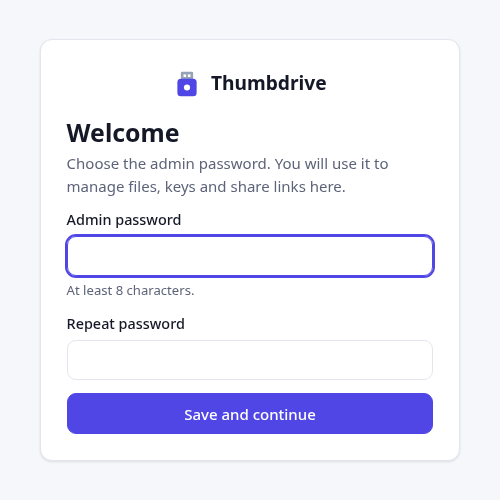
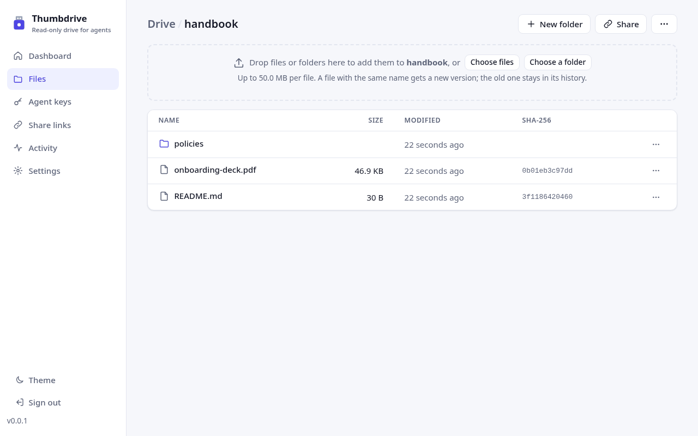
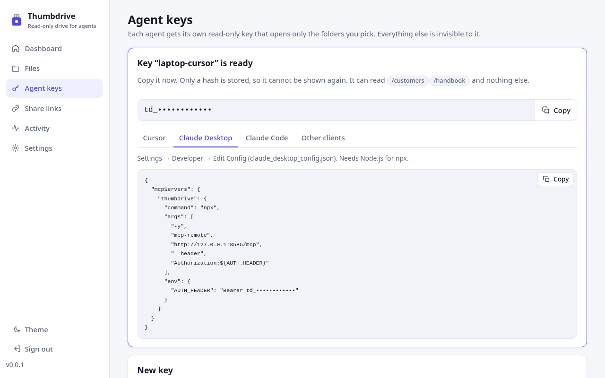
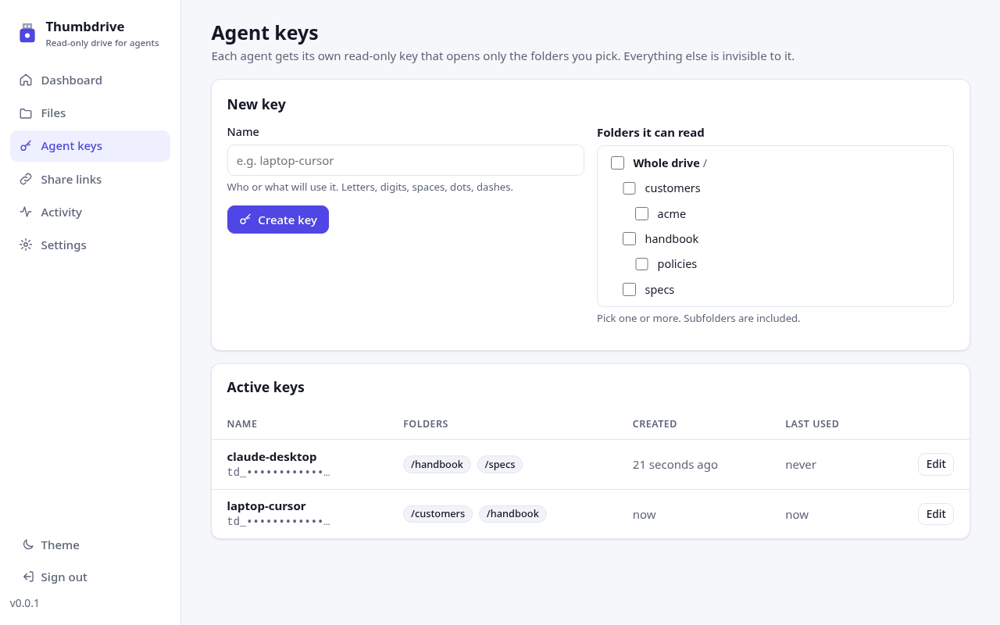
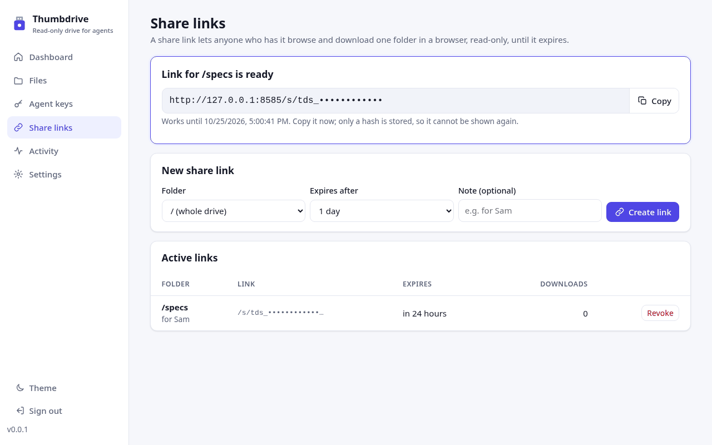
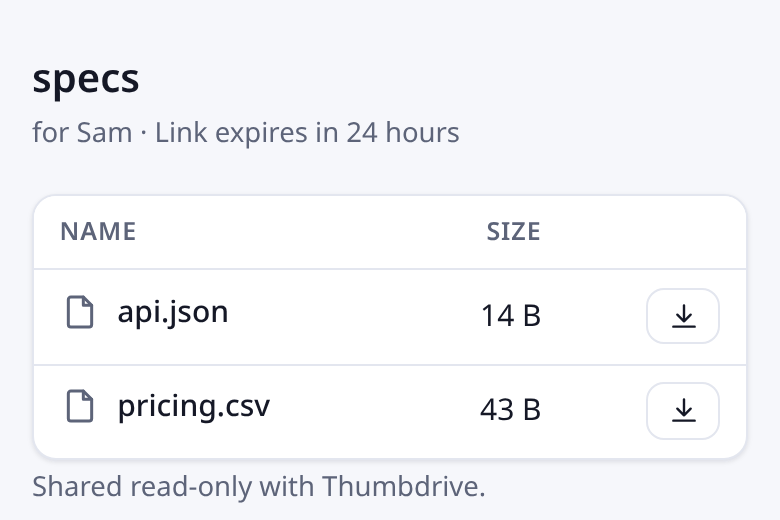
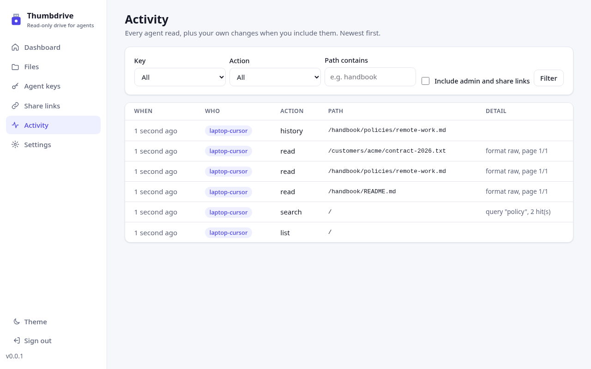
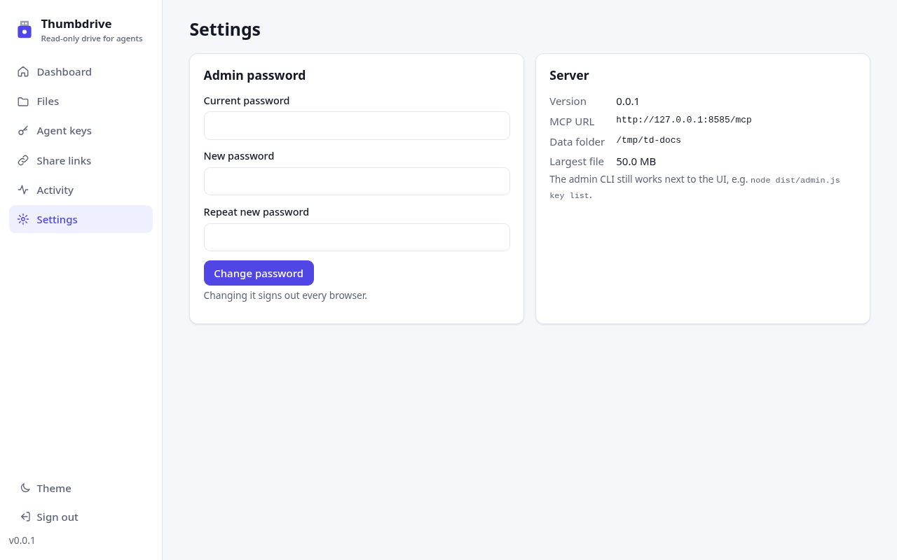
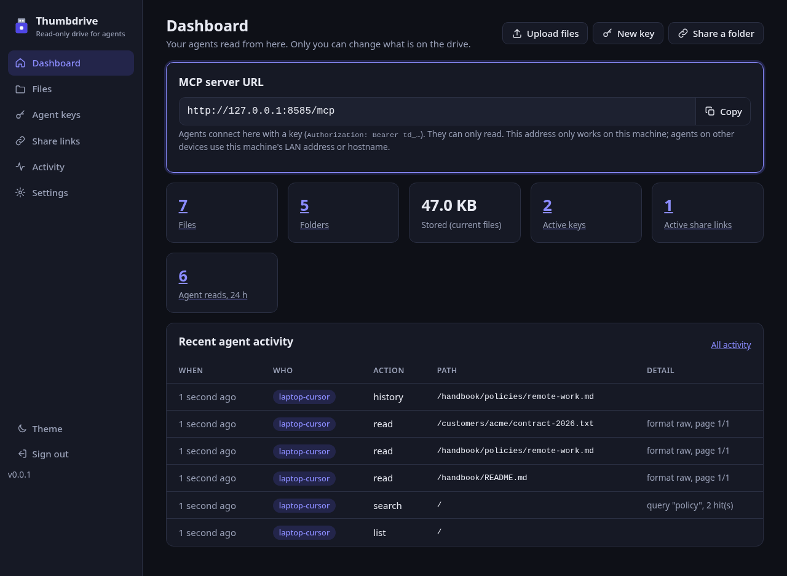
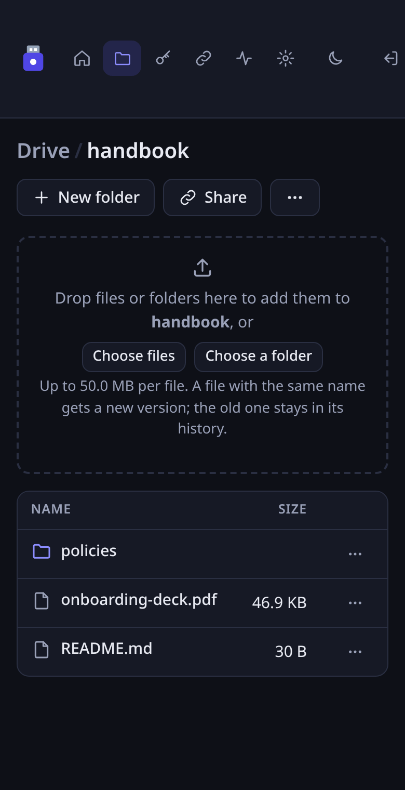

# Web UI guide

Thumbdrive has a web UI for the admin (you). Agents never use it: they connect to `/mcp` with a read-only key. The UI is served at `/` on the same port as `/mcp`, which is `8484` by default.

- [First run and signing in](#first-run-and-signing-in)
- [Dashboard](#dashboard)
- [Files](#files)
- [Versions and restore](#versions-and-restore)
- [Agent keys and client snippets](#agent-keys-and-client-snippets)
- [Share links](#share-links)
- [Activity](#activity)
- [Settings and the admin password](#settings-and-the-admin-password)
- [Themes and phones](#themes-and-phones)

For the security model behind these screens, see [security.md](security.md). For every setting and CLI command, see [configuration.md](configuration.md).

## First run and signing in

Open `http://HOST:8484/`. If no admin password exists yet, you get **Welcome**. Choose a password of at least 8 characters, enter it twice and click **Save and continue**. You are signed in and land on the dashboard.

Until a password is set, anyone who can reach the port can set it. Do this right after you start the server, or set it before the first start with `THUMBDRIVE_ADMIN_PASSWORD` or `node dist/admin.js set-password`.

After that, the UI shows a sign-in page. A session lasts 7 days. **Sign out** is at the bottom of the sidebar.

## Dashboard

- **MCP server URL.** The address agents connect to, with a **Copy** button. It is built from the address you opened the UI on. If agents reach the server by another address, such as a hostname or an HTTPS proxy, set `THUMBDRIVE_PUBLIC_URL`.
- **Counts.** Files, folders, the size of the current files, active keys, active share links, and agent reads in the last 24 hours. Each count links to its page.
- **Recent agent activity.** The latest reads by your agents. **All activity** opens the full log.
- The buttons at the top go straight to uploading, creating a key and sharing a folder.

## Files

**Files** is the drive. Click a folder to open it. The breadcrumb at the top takes you back up.

- **Upload.** Drag files, or a whole folder with its subfolders, onto the drop area. You can also use **Choose files** or **Choose a folder**. Each file can be up to `MAX_FILE_MB` (50 MB by default). If a file with the same name exists, the upload becomes its next version. The old content stays in the history.
- **New folder** creates a folder inside the current one.
- **Share** creates a share link for the current folder (see [Share links](#share-links)).
- **⋯ at the top** renames, moves or deletes the current folder. Deleting a folder deletes the files in it. Their history is kept, so you can restore them.
- **⋯ on a row** downloads, renames or moves, opens the history of, or deletes that file or folder.
- **Moving a folder** also moves the agent keys and share links that point into it, so they keep working.

Deleted files are listed under **Deleted from this folder** at the bottom of their folder, where you can restore them. Files from a deleted folder are listed on the nearest folder that still exists, with their folder path (for example `drafts/notes.txt`). Restoring one brings its folder back.

## Versions and restore

Click a file name to open its page. The top card shows the size, the current version, when it changed and the full SHA-256. Agents get the same SHA-256 with every read, so they can check that they got these exact bytes.

**Version history** lists every stored version, newest first:

- The download icon downloads that version.
- **Restore** makes that version current again. Restoring adds a new version, so it never erases anything. In the example above, restoring v1 would create v4 with v1's content.

The page also has **Download**, **Rename or move** and **Delete file**. A delete is recorded as a version too, so a deleted file can be restored.

## Agent keys and client snippets

Each agent gets its own key. A key can only read, and only the folders you tick. Everything else answers `Not found`, the same as a file that does not exist.

To create one:

1. Enter a **Name**, such as `laptop-cursor`. Use letters, digits, spaces, dots and dashes.
2. Under **Folders it can read**, tick one or more folders. Subfolders are included. **Whole drive /** gives access to everything.
3. Click **Create key**.

The key (`td_` followed by 43 characters) is shown **once**, with a **Copy** button. Only a hash is stored. If you lose the key, revoke it and create a new one. (Keys and links are masked in these screenshots.)

Below the key are ready-to-paste configs. Each one already contains the key and the server URL:

| Tab | Where it goes |
| --- | --- |
| Cursor | `~/.cursor/mcp.json`, or `.cursor/mcp.json` in a project |
| Claude Desktop | Settings → Developer → Edit Config (`claude_desktop_config.json`). This uses the `mcp-remote` bridge, which needs Node.js on that machine. For a plain-HTTP LAN address, `--allow-http` is added for you. |
| Claude Code | A `claude mcp add --transport http ...` command |
| Other clients | The URL and the `Authorization: Bearer td_...` header, for any client that supports Streamable HTTP |

Restart the client and ask it to "list my Thumbdrive". It should see four read-only tools: `list`, `read`, `search` and `history`.

**Active keys** shows each key's name, the first characters of the key, its folders, and when it was created and last used. **Edit** changes a key's folders without changing the key itself. **Revoke** turns a key off at once.

## Share links

A share link lets a person, not an agent, browse and download one folder in a browser. They don't need a password or a key.

1. Pick a **Folder**. You can also click **Share** on a folder in **Files**.
2. Pick **Expires after**: 1 hour, 1 day (the default), 7 days or 30 days.
3. Optionally add a **Note**, such as `for Sam`. The person sees it on the page.
4. Click **Create link**. The link (`/s/tds_...`) is shown once, with a **Copy** button. Only a hash is stored.

**Active links** shows each link's folder, the start of the link, when it expires and how many downloads it has had. **Revoke** ends a link at once. Expired links stop working by themselves.

The person sees a plain, read-only page with the folder's files and subfolders. It works on phones and follows their light or dark setting:

A link only opens its own folder. It cannot reach anything above or beside it.

## Activity

**Activity** lists every agent read, newest first: when, which key, which tool (`list`, `read`, `search` or `history`), the path, and details such as the page that was read or the search query.

You can filter by **Key**, by **Action**, and by text in the path (**Path contains**). Tick **Include admin and share links** to also see your own changes (uploads, moves, deletes, restores, keys, password changes) and share-link downloads.

The CLI shows the same log with `node dist/admin.js activity [count]`.

## Settings and the admin password

**Admin password** changes the password. Enter the current password and the new one twice (at least 8 characters). Changing it signs out every other browser session.

If `THUMBDRIVE_ADMIN_PASSWORD` is set, the page says so. On every start, the server sets the password back to that value if it differs.

**Server** shows the version, the MCP URL, the data folder and the largest file you can upload.

Forgot the password? Run `node dist/admin.js set-password` on the server, or in the container console. See [configuration.md](configuration.md#set-password).

## Themes and phones

**Theme** in the sidebar switches between light and dark. By default the UI follows your system setting. On a narrow screen, the sidebar becomes an icon bar at the top.

  
  

