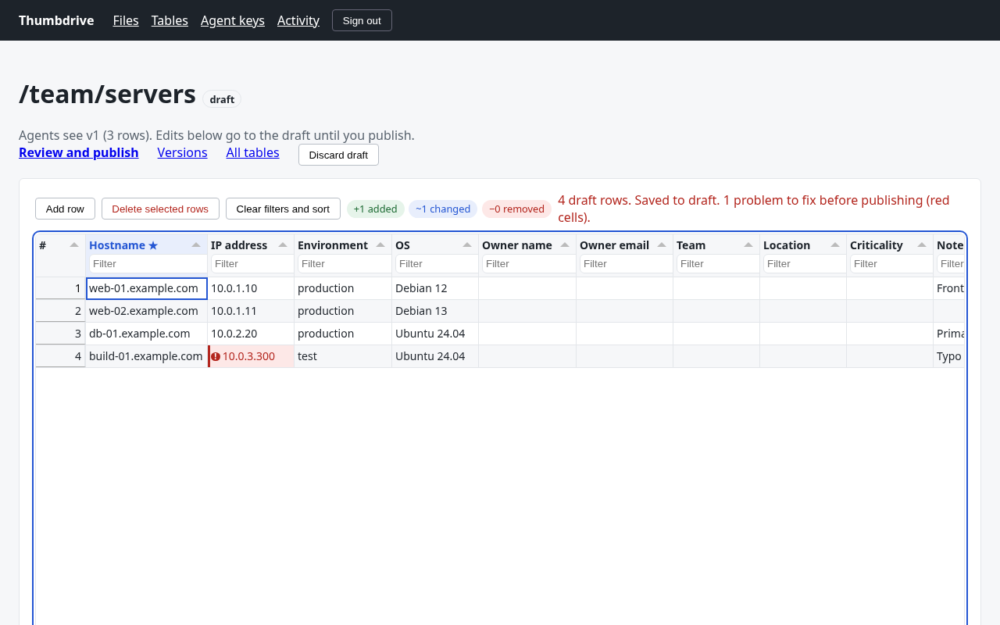
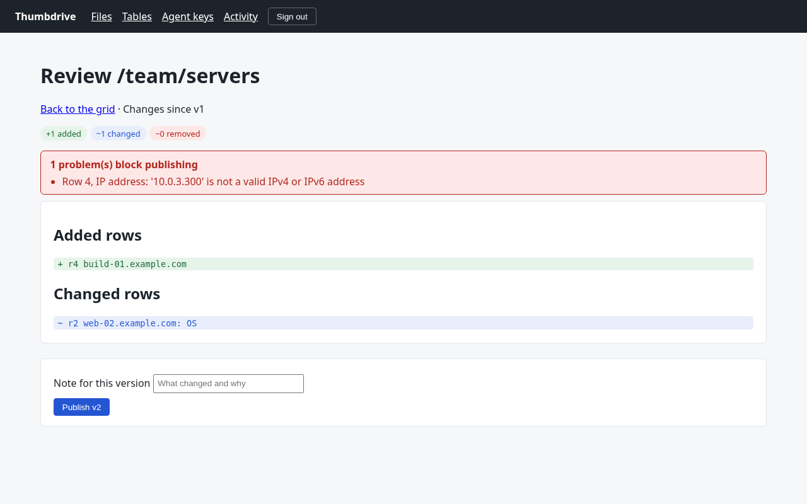
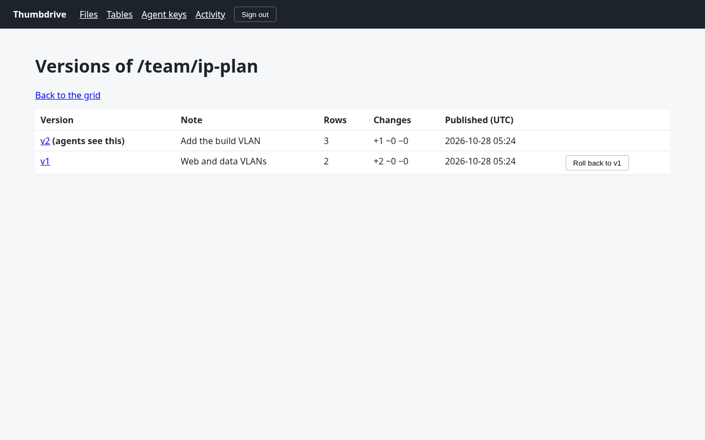
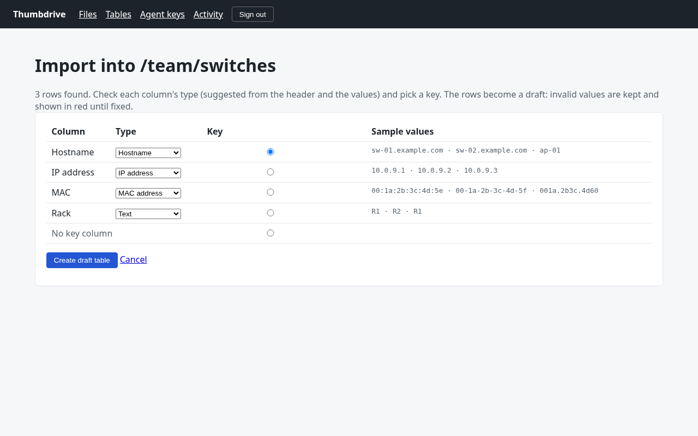

# Thumbdrive, Python edition

A small, self-hosted, read-only "virtual USB drive" for AI agents. You put files in it through a web UI; agents read them over MCP with a key that only opens the folders you choose.

This is a deliberately simple rewrite of the TypeScript app in the repository root. It aims to stay easy to read and maintain for a long time: about 2,900 lines of Python, five direct dependencies, plain files plus one SQLite database. See [DESIGN.md](DESIGN.md) for the reasoning.

## Quick start

Needs Python 3.12+ and [uv](https://docs.astral.sh/uv/).

```sh
cd python
uv run thumbdrive --dev     # or: make dev
```

`--dev` uses `./dev-data`, adds sample files, sets the admin password to `thumbdrive-dev` and prints an agent key for `/team` and `/research`. It also seeds two tables: `/team/servers` (published once, with a draft change and one invalid IP) and `/team/ip-plan` (two published versions). Open <http://127.0.0.1:8484/>.

For real use, run `uv run thumbdrive` (or `python -m thumbdrive`) and open `/setup` to choose the admin password, or set `THUMBDRIVE_ADMIN_PASSWORD`.

With Docker: `docker compose up --build` in this directory (publishes on 127.0.0.1:8484 only).

## What it does

- **Files**: browse, create/rename/delete folders, upload any file type, download, delete. Every change is a new version; the versions page downloads or restores any of them, including deleted files.
- **Agent keys**: a key is scoped to one or more folders, shown once, stored as a SHA-256 hash, and revocable. The page shows ready-to-paste config for Cursor, Claude Desktop (through `mcp-remote`), Claude Code and other clients.
- **Tables**: typed rows such as a server inventory or an IP plan, edited in a spreadsheet-like grid. See [Tables](#tables).
- **Activity**: every agent tool call, filterable by key.
- **MCP** at `/mcp` (Streamable HTTP, `Authorization: Bearer <key>`). Eight read-only tools:

| Tool | What it does |
| --- | --- |
| `list(path)` | Files and folders with size, SHA-256 and modified time |
| `read(path, page, version)` | Metadata JSON (version, size, sha256, mime, page, pages, has_more) then the text of that page. Binary files return metadata only |
| `search(query, path)` | Case-insensitive match on file names and text content, up to 50 hits |
| `history(path)` | Stored versions, newest first |
| `list_tables(path)` | Published tables in the key's folders: path, description, version, rows, key column, citation |
| `describe_table(table)` | Columns (type, options, key) and five sample rows of the latest version |
| `lookup_row(table, values, column)` | Find rows by up to 50 values, normalized by the column type. In a CIDR column an IP returns the most specific range that contains it; a short host name matches its FQDN. Each value answers `match`, `no_match`, `ambiguous` or `invalid` |
| `query_table(table, where, order_by, descending, limit, offset)` | Up to 10 conditions (`eq`, `neq`, `contains`, `starts_with`, `gt`, `lt`, `in`, `is_empty`), sorted and paged (max 200 rows) |

Table rows come back as `{row_id, citation, values}`; a citation such as `thumbdrive:/team/servers@v3#r12` names the table, version and row, and is accepted wherever a table path is.

Anything outside a key's folders answers `Not found`, exactly like a missing file.

## Tables



- **Create** a blank table, start from a template (*Server inventory*, *IP plan / VLANs*), or **import a CSV** (UTF-8, `,` `;` or tab separated). The import preview suggests a type for each column from its header and values; you pick types and a key column. XLSX is not read: save the sheet as CSV.
- **Column types**: text, long text, number, date, checkbox, single select, URL, email, hostname, IP address, CIDR range, MAC address. Values are stored in a canonical form (`2001:DB8::1` → `2001:db8::1`, `001a.2b3c.4d5e` → `00:1A:2B:3C:4D:5E`). The key column must be unique and filled.
- **Grid** ([Tabulator](https://tabulator.info) 6.7.1, MIT, vendored in `static/vendor/tabulator/`): edit cells, move with the keyboard, add and delete rows, paste a block from Excel or Google Sheets (rows with a known key are updated, others appended), sort and filter, and add, rename or delete columns. Invalid cells turn red; the reason is in the cell's tooltip and in the status line when you click it. Every edit is saved to the draft at once.
- **Draft, review, publish**: agents only ever see the latest published version. The review page lists added, changed and removed rows and any problems; problems block publishing. Publishing needs a short note.
- **Versions**: every published version is kept; *Roll back* publishes an old one again as a new version.

| Review | Versions | Import |
| --- | --- | --- |
|  |  |  |

Tables live at paths inside the drive's folders, so a key's folders decide which tables an agent sees. Renaming a folder moves its tables; a folder that still holds tables cannot be deleted.

## Configuration

| Variable | Default | |
| --- | --- | --- |
| `THUMBDRIVE_HOST` | `127.0.0.1` | Address to listen on (`0.0.0.0` in the container) |
| `THUMBDRIVE_PORT` | `8484` | |
| `DATA_DIR` | `./data` | Files, versions and `thumbdrive.db` |
| `THUMBDRIVE_ADMIN_PASSWORD` | | Sets the admin password at start (8+ characters). Otherwise use `/setup` |
| `THUMBDRIVE_PUBLIC_URL` | | Public address, e.g. `https://drive.example.com`. Used in key snippets; its host is allowed; `https` turns on `Secure` cookies |
| `ALLOWED_HOSTS` | | Extra host names accepted in `Host`/`Origin`, comma separated. Localhost and private IPs are always accepted |
| `MAX_FILE_MB` | `50` | Largest upload |
| `READ_PAGE_BYTES` | `65536` | Bytes per `read` page |

## HTTPS

The server speaks plain HTTP and binds to loopback by default. To reach it from other machines, put a reverse proxy in front and set `THUMBDRIVE_PUBLIC_URL`. Caddy:

```
drive.example.com {
    reverse_proxy 127.0.0.1:8484
}
```

Traefik (compose labels): `traefik.http.routers.thumbdrive.rule=Host(\`drive.example.com\`)`, `traefik.http.routers.thumbdrive.tls.certresolver=le`, `traefik.http.services.thumbdrive.loadbalancer.server.port=8484`.

Claude Desktop's `mcp-remote` refuses plain HTTP to non-local hosts; the snippet adds `--allow-http` when needed. Prefer HTTPS.

## Security

Admin password hashed with scrypt; sessions are random tokens stored hashed, in `HttpOnly; SameSite=Strict` cookies; every POST checks a CSRF token plus `Sec-Fetch-Site`/`Origin`; 10 failed logins per 15 minutes per client; strict CSP and other security headers; unknown `Host` headers are refused (DNS rebinding). Downloads are always `attachment` with a sandbox CSP.

## Development

```sh
make test    # pytest: web auth/CSRF, key scoping, each MCP tool through the official SDK client, versions, search, tables
make lint    # ruff check + ruff format --check
```

## Differences from the TypeScript edition

Dropped on purpose, to keep it small: share links for people, themes and mobile polish, the dashboard and settings pages (change the password with `THUMBDRIVE_ADMIN_PASSWORD`), PDF/Word/Excel text extraction and CSV-as-rows reads (binary files are metadata-only to agents), base64 reads, editing a key's folders (revoke and create a new one), per-key rate limiting, the admin CLI and `--stdio` mode, drag-and-drop folder upload, XLSX import, and the refusal of plain HTTP from public addresses (bind to loopback and use a proxy instead). The port variable is `THUMBDRIVE_PORT` rather than `PORT`. The on-disk format is not shared with the TypeScript edition.

| | TypeScript (`src/`) | Python (`python/src/`) |
| --- | --- | --- |
| Application code | 4,941 lines | 2,852 lines of Python + 1,205 lines of templates, CSS, JS and SQL (plus vendored Tabulator) |
| Tests | 1,238 lines | 835 lines |
